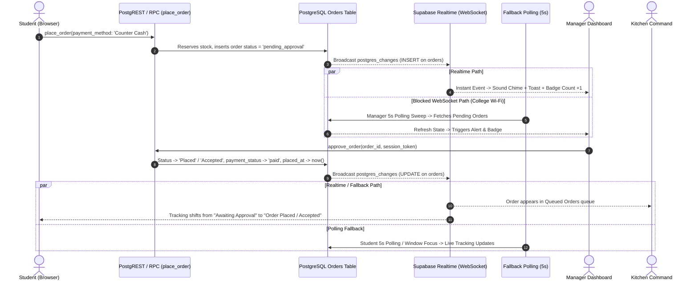

# Stage 5 Audit & Implementation Notes: Connectivity, Resiliency & Hardening
**Project:** SmartCanteen (Team UNDERCUT DEV — Problem Statement 76)  
**Date:** October 2026  
**Scope:** Stage 5 Addons & Hardening

---

## 0. Schema & Function Audit Report

### Root Cause Analysis: `record "v_settings" has no field "timezone"` in `place_order`
- **Issue:** When executing `place_order`, PostgreSQL throws:
  `ERROR: record "v_settings" has no field "timezone"`
- **Why this occurred:**
  In `supabase/stage4_addons.sql` (and `stage3_addons.sql`), `place_order` was defined with:
  ```sql
  v_day_start := date_trunc('day', timezone(coalesce(v_settings.timezone, 'Asia/Kolkata'), now()));
  ```
  Variable `v_settings` is declared as `public.kitchen_settings%rowtype`. In the core database migration (`supabase/migrations/20261010142130_canteen_core.sql`), the `public.kitchen_settings` table was defined with columns:
  - `singleton`, `max_kitchen_capacity`, `rush_multiplier`, `batching_threshold`, `auto_batching_enabled`, `canteen_open`, `w_pickup_urgency`, `w_prep_time`, `w_priority`, `auto_accept`, `demo_mode`, `created_at`, `updated_at`.
  - In Stage 4, `pending_expiry_minutes` and `counter_approver` were added.
  - However, **no `timezone` column was ever created on `kitchen_settings`**.
  - When PL/pgSQL executed `v_settings.timezone`, the composite row type lacked the attribute, causing a fatal runtime exception during order creation.

### Comprehensive Audit of all Functions across Stage 2, Stage 3, Stage 4 & Core Migrations

| Function | Source SQL | Objects / Columns Referenced | Audit Findings & Verification | Action in `stage5_addons.sql` |
|---|---|---|---|---|
| `place_order` | `stage4_addons.sql` | `kitchen_settings.timezone`, `orders.status`, `orders.student_name`, `orders.student_roll` | Missing `timezone` column on `kitchen_settings`. `p_student_name` lacked mandatory regex validation. | Add column `timezone text not null default 'Asia/Kolkata'` on `kitchen_settings`. Update `place_order` with mandatory name validation and safe timezone fallback. |
| `get_pickup_slots` | `20261010142130_canteen_core.sql` | `kitchen_settings.timezone`, `kitchen_settings.canteen_open`, `orders.status` | Hardcoded `'Asia/Kolkata'` string instead of reading configured `kitchen_settings.timezone`. | Update `get_pickup_slots` to dynamically respect `coalesce(v_settings.timezone, 'Asia/Kolkata')`. |
| `approve_order` | `stage4_addons.sql` | `orders.status`, `orders.placed_at`, `orders.accepted_at`, `role_sessions` | Valid. Does not set `cancelled_at`. | Keep valid logic, ensure correct grants. |
| `reject_order` | `stage4_addons.sql` | `orders.cancelled_at`, `orders.cancel_reason`, `menu_items.stock` | `cancelled_at` was not populated during reject. | Update `reject_order` to explicitly set `cancelled_at = now()`. |
| `cancel_order` | `stage4_addons.sql` | `orders.cancelled_at`, `orders.cancel_reason`, `menu_items.stock` | `cancelled_at` was not populated on student/staff cancel. | Update `cancel_order` to explicitly set `cancelled_at = now()`. |
| `expire_pending_orders` | `stage4_addons.sql` | `orders.cancelled_at`, `kitchen_settings.pending_expiry_minutes` | `cancelled_at` was not populated on automated expiry. | Update `expire_pending_orders` to set `cancelled_at = now()`. |
| `update_kitchen_settings` | `stage4_addons.sql` | `kitchen_settings` parameters | Missing `p_timezone` parameter to allow managers to configure canteen timezone. | Add `p_timezone text default null` to `update_kitchen_settings`. |
| `set_item_availability` | `stage3_addons.sql` | `menu_items.is_available` | Valid. Column added in stage 3. | Valid. |
| `update_order_status` | `stage2_addons.sql` | `orders.accepted_at`, `orders.preparing_at`, `orders.ready_at`, `orders.collected_at` | Valid transitions: Placed -> Accepted -> Preparing -> Ready -> Collected. | Valid. |
| `verify_pickup` | `stage2_addons.sql` | `orders.token`, `orders.id` | Valid. | Valid. |
| `set_item_stock` / `restock_item` | `stage2_addons.sql` | `menu_items.stock` | Valid. | Valid. |
| `verify_role_session` | `stage2_addons.sql` | `role_sessions.token_hash`, `role_sessions.expires_at` | Valid. | Valid. |

---

## 1. Student-to-Manager Connectivity & Hop-by-Hop Trace

### Lifecycle of a Pay-at-Counter Order


### Hop-by-Hop Failure Mode Analysis & Hardening
1. **Hop 1: Checkout -> `place_order`**
   - *Potential Failure:* Invalid student roll format, missing/invalid name, closed canteen, or schema error (such as missing `timezone`).
   - *Mitigation:* Client validates USN regex and name regex (2-50 chars). Server RPC validates USN and name before checking stock.
2. **Hop 2: Database Insertion -> `pending_approval`**
   - *Potential Failure:* `orders_status_check` constraint rejecting `pending_approval`.
   - *Mitigation:* `orders_status_check` constraint explicitly altered to include `pending_approval`.
3. **Hop 3: `pending_approval` -> Manager Approvals Inbox**
   - *Potential Failure:*
     a) Realtime WebSocket blocked by captive portal / restrictive college firewall.
     b) Table not published in `supabase_realtime`.
     c) RLS policy blocking `anon` from reading pending orders.
   - *Mitigation:*
     - Idempotent `alter publication supabase_realtime add table public.orders, public.order_items, public.menu_items, public.kitchen_settings;`
     - Automatic 5-second polling fallback in `canteenState.js` whenever Realtime is not in `SUBSCRIBED` state.
     - Event listeners on `window.focus` and `document.visibilitychange` to trigger immediate refetch.
     - Exponential backoff resubscription strategy.
4. **Hop 4: Manager `approve_order` -> Kitchen Queue**
   - *Potential Failure:* Unauthorized session token or order already expired.
   - *Mitigation:* Manager session validation. If expired, friendly feedback is returned. On approval, slot recalculation is performed.
5. **Hop 5: Kitchen Queue -> Student Tracking**
   - *Potential Failure:* Realtime update missed by student phone on slow cellular or locked screen.
   - *Mitigation:* Student view polls every 5 seconds; re-syncs state immediately on screen unlock / tab visibility change.

### Personal Data Exposure Report (Anon SELECT Role)
- **Current Setup:** In the public prototype, `anon` role is granted `SELECT` on `public.orders` and `public.order_items`.
- **Exposed Data Fields:**
  - `student_roll`: College USN (e.g. `1GA24CS012`).
  - `student_name`: Student full name.
  - Order contents: Food items, quantities, price, timestamp, payment method.
- **Privacy Assessment:**
  - Without full student authentication (e.g. Supabase Auth with student email/SSO), client-side filtering by USN is used. Any user opening DevTools network tab could query `/rest/v1/orders?select=*` and inspect campus-wide orders.
  - In Stage 6 (Production Auth), RLS policies must restrict order reads using JWT student claims or session-bound tokens.

---

## 2. Mandatory Student Name Specifications
- **Format Requirements:** 2 to 50 characters. Allowed characters: English letters (`A-Za-z`), spaces, apostrophes (`'`), periods (`.`), and hyphens (`-`). Regex: `^[A-Za-z\s.'-]{2,50}$`.
- **Client Implementation:**
  - `StudentUSNModal.jsx`: Name is a mandatory field with real-time regex validation and inline error display. Save button is disabled until both USN and Name are valid.
  - `CheckoutModal.jsx`: Name is validated with inline feedback; Confirm Order button is disabled if the name is blank or invalid.
- **Server Implementation (`place_order`):**
  ```sql
  if p_student_name is null or trim(p_student_name) !~ '^[A-Za-z\s.''-]{2,50}$' then
    return jsonb_build_object(
      'ok', false,
      'reason', 'invalid_name',
      'message', 'Student name is required (2-50 characters; letters, spaces, dots, hyphens, and apostrophes only).'
    );
  end if;
  ```

---

## 3. Auto-Hiding Cancelled Orders After 5 Minutes
- **Database Column:** `orders.cancelled_at timestamptz`.
- **Backfill:** Old cancelled rows (`status = 'Cancelled' and cancelled_at is null`) are backfilled with `coalesce(placed_at, now())`.
- **Trigger Points:** Set `cancelled_at = now()` inside `cancel_order`, `reject_order`, and `expire_pending_orders`.
- **Client Auto-Hide Logic:**
  - Student Tracking tabs and Kitchen Command "Cancelled Orders" card filter out any order where `status == 'Cancelled'` and `Date.now() - new Date(order.cancelledAt).getTime() > 5 * 60 * 1000`.
  - Re-evaluated automatically every 30 seconds and on state load.
  - Students can still manually dismiss cancelled/expired tabs immediately using the ✕ button (persisted per-USN in `localStorage`).
- **Manager Audit View:** Never deletes rows. Manager view includes a collapsible "Order History (Today)" table displaying all of today's orders (including cancelled and expired ones) for financial and audit tracking.

---

## 4. Friendly Error Mapping
Raw database exceptions and PostgreSQL internal error strings are never displayed to students. `canteenState.js` maps errors through `sanitizeErrorMessage(error)`:

| Raw / Technical Error | User-Facing Friendly Message |
|---|---|
| `record "v_settings" has no field...` | "Order system encountered a temporary glitch. Please try again." |
| `invalid_usn` / `orders_student_roll_format` | "Invalid college USN format. Please enter a valid USN (e.g. 1GA24CS012)." |
| `invalid_name` | "Please enter a valid student name (2-50 characters, letters only)." |
| `canteen_closed` | "The canteen is currently closed. Please check back during operating hours." |
| `sold_out` | "One or more items in your cart just sold out. Please review your cart." |
| `capacity_full` | "The kitchen is currently at peak capacity. Please select an available future pickup slot." |
| `forbidden_role` / `forbidden` | "Permission denied. Please verify your staff credentials." |
| `network error` / `Failed to fetch` | "Connection issue. Reconnecting to canteen servers..." |
| Unknown / Unmapped Error | "Something went wrong. Please try again." *(technical details logged to console)* |

---

## 5. Timezone Standardization
- Timezone is standardized to `kitchen_settings.timezone` (defaulting to `'Asia/Kolkata'`).
- Display helpers format all pickup slot times and countdown clocks consistently using `Intl.DateTimeFormat` / `toLocaleTimeString` with the configured timezone.
